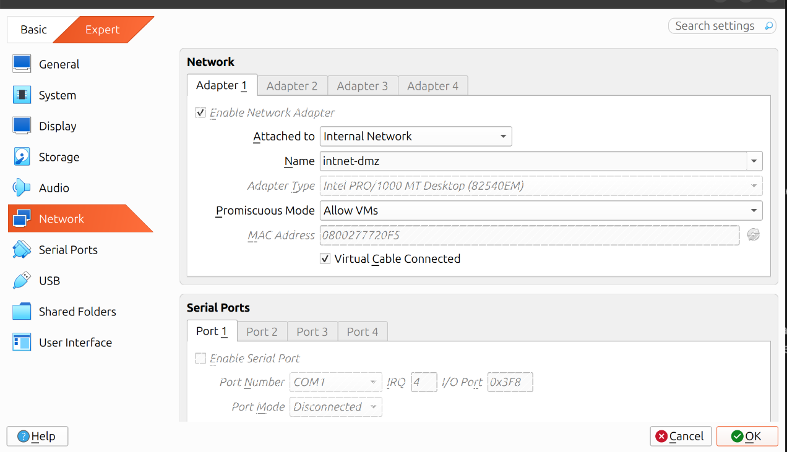
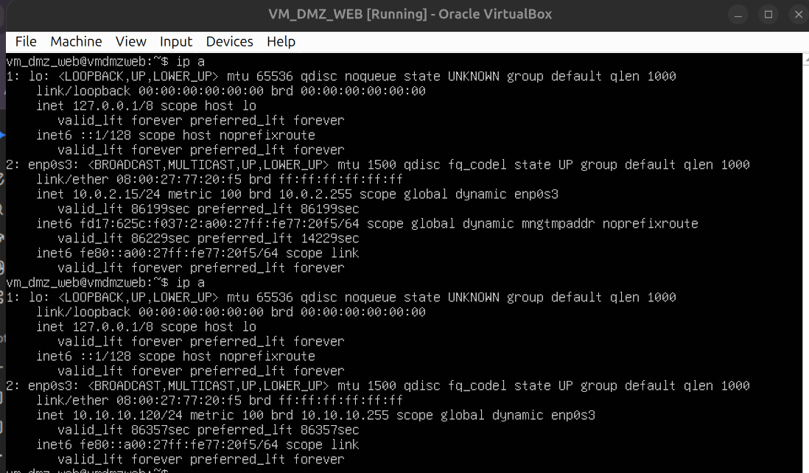
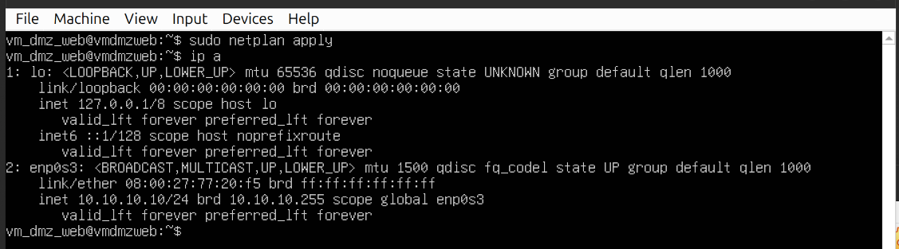
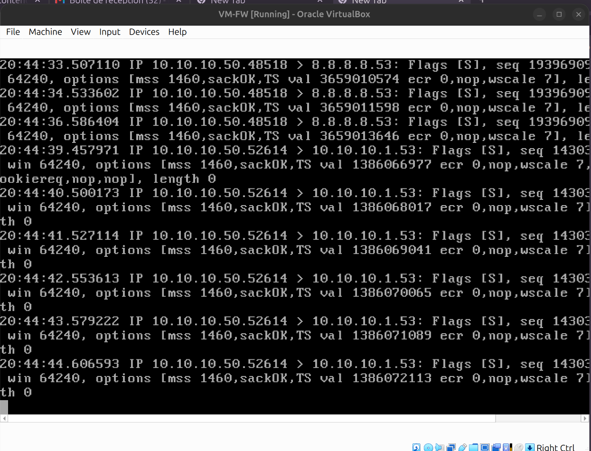
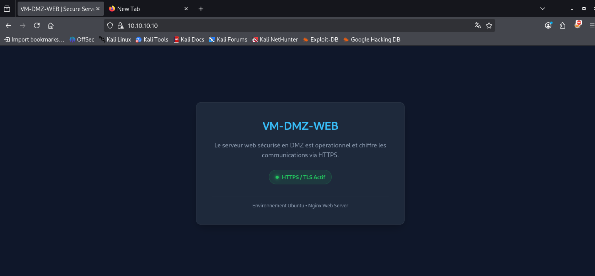
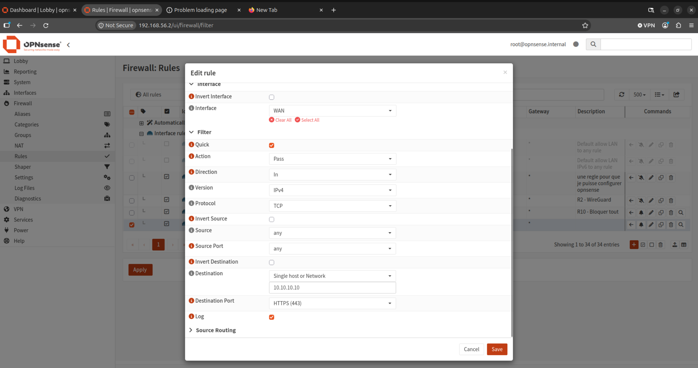
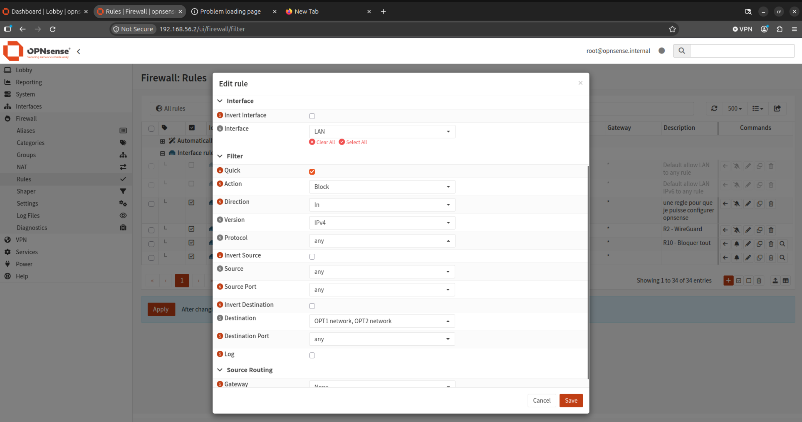
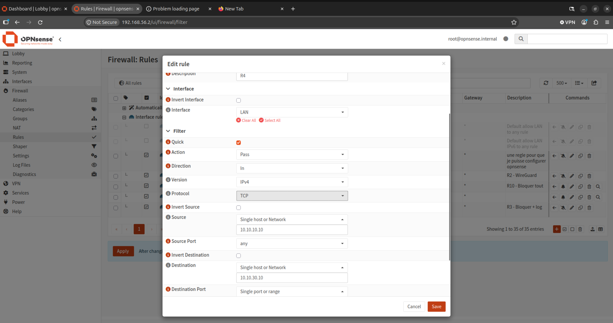
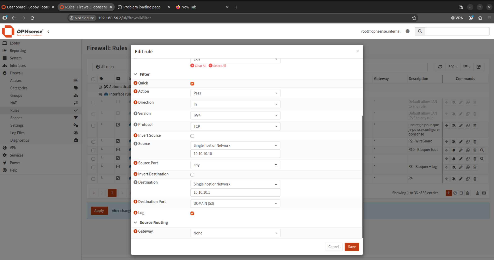

# Partie 1 : DMZ (VLAN 10, em1)

## 1. Vue d'ensemble

| Élément | Détail |
|---|---|
| Réseau | 10.10.10.0/24, passerelle 10.10.10.1 |
| VM | VM-DMZ-WEB, 10.10.10.10, Ubuntu Server, Nginx, agent Wazuh, 1 Go RAM |
| DHCP | Aucun, IP fixe |
| Nom du serveur | `vm_dmz_web` |
| Mot de passe | `sitcn` (lab uniquement) |

---

## 2. Connexion de la VM à em1 (10.10.10.0/24)

### 2.1 Carte réseau dans VirtualBox

Changer le mode de la carte réseau en **Réseau interne** (Internal Network).



Vérification :



### 2.2 IP statique avec Netplan

Créer le fichier `/etc/netplan/01-netcfg.yaml` :

```yaml
network:
  version: 2
  ethernets:
    enp0s3:
      dhcp4: no
      addresses:
        - 10.10.10.10/24
      routes:
        - to: default
          via: 10.10.10.1
      nameservers:
        addresses: [10.10.10.1, 8.8.8.8]
```

Appliquer les changements :

```bash
sudo netplan apply
```

> **Note :** en cas de problème de configuration, supprimer les autres fichiers présents dans `/etc/netplan/` et ne garder que `01-netcfg.yaml` pour éviter les conflits de structure.

### 2.3 Vérification

Sur **VM-DMZ-WEB** :



Sur **VM-FW** (OPNsense) :



---

## 3. Configuration de Nginx

### 3.1 Installation

```bash
sudo apt update && sudo apt install -y nginx
```

### 3.2 Certificat auto-signé

```bash
sudo openssl req -x509 -nodes -days 365 -newkey rsa:2048 \
  -keyout /etc/ssl/private/nginx-selfsigned.key \
  -out /etc/ssl/certs/nginx-selfsigned.crt
```

Vérification :

```bash
sudo ls -l /etc/ssl/certs/nginx-selfsigned.crt /etc/ssl/private/nginx-selfsigned.key
```

### 3.3 Fichier de configuration du site

```bash
sudo nano /etc/nginx/sites-available/vm-dmz-web.conf
```

Contenu :

```nginx
server {
    listen 80;
    server_name _;
    return 301 https://$host$request_uri;
}

server {
    listen 443 ssl;
    server_name _;

    ssl_certificate /etc/ssl/certs/nginx-selfsigned.crt;
    ssl_certificate_key /etc/ssl/private/nginx-selfsigned.key;

    ssl_protocols TLSv1.2 TLSv1.3;
    ssl_ciphers HIGH:!aNULL:!MD5;
    add_header Strict-Transport-Security "max-age=31536000; includeSubDomains" always;

    root /var/www/html;
    index index.html;

    location / {
        try_files $uri $uri/ =404;
    }
}
```

### 3.4 Activation du site

```bash
sudo ln -s /etc/nginx/sites-available/vm-dmz-web.conf /etc/nginx/sites-enabled/
```

### 3.5 Page d'accueil

Placer le fichier [index.html](./index.html) dans `/var/www/html/index.html`.

### 3.6 Test et redémarrage

```bash
sudo nginx -t
sudo systemctl restart nginx
```



---

## 4. Pare-feu de la VM (UFW)

```bash
sudo ufw default deny incoming
sudo ufw default allow outgoing
sudo ufw allow OpenSSH
sudo ufw allow 'Nginx Full'
sudo ufw enable
```

---

## 5. Règles OPNsense

Voir aussi : [Reverse proxy](../04-reverse-proxy/readme.md)

### 5.1 Autoriser HTTPS vers la DMZ

Créer la règle, l'enregistrer, puis cliquer sur **Apply changes** (bouton rouge en haut de la page). La règle doit apparaître active, avec une icône verte, dans le tableau des règles WAN.



### 5.2 R3 : blocage



### 5.3 R4



### 5.4 R6

